<div align="center">

*Université Cheikh Anta Diop*


**École Supérieure Polytechnique**
**Département Génie Informatique**

*Année Universitaire 2026-2027*

**Licence 3 en Génie Logiciel et Système d'Information (L3 GLSI-C)**

---

# Compte rendu du TP

## Configuration et utilisation de VNC et noVNC

*Cours : Services Réseaux Avancés*
*Enseignant : Dr GUEYE*

---

**Étudiants : Ehi Diamhen Winter, Mamadou DIA**

</div>

---

## Sommaire

1. [Environnement de travail](#environnement-de-travail)
2. [Partie 1 : Installation et configuration du serveur VNC](#partie-1--installation-et-configuration-du-serveur-vnc)
3. [Partie 2 : Connexion depuis une machine cliente](#partie-2--connexion-depuis-une-machine-cliente)
4. [Partie 3 : Sécurisation de la connexion VNC avec un tunnel SSH](#partie-3--sécurisation-de-la-connexion-vnc-avec-un-tunnel-ssh)
5. [Partie 4 : Accès via navigateur avec noVNC](#partie-4--accès-via-navigateur-avec-novnc)
6. [Questions de réflexion](#questions-de-réflexion)
7. [Conclusion](#conclusion)

---

## Environnement de travail

| Rôle | Machine | Système | Adresse IP |
|---|---|---|---|
| Serveur VNC | `ubuntu-rsx` (VM KVM/virt-manager) | Ubuntu 24.04 LTS | `192.168.122.116` (réseau NAT libvirt) |
| Client VNC | `HIRA` (machine hôte) | Ubuntu (Linux) | `192.168.122.1` (passerelle libvirt) |

- **Serveur** : machine Linux, utilisateur `vboxuser`.
- **Client** : machine Linux, avec le client graphique `tigervnc-viewer`.

---

## Partie 1 : Installation et configuration du serveur VNC

### 1. Mise à jour de la machine

```bash
sudo apt update && sudo apt upgrade -y
```

### 2. Installation du serveur VNC

```bash
sudo apt install tigervnc-standalone-server -y
which vncserver
```

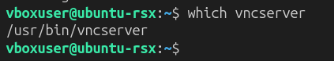

Le binaire `/usr/bin/vncserver` est bien présent.

### 3. Configuration de l'environnement de bureau

```bash
sudo apt install xfce4 xfce4-goodies dbus-x11 -y
which startxfce4
```

> `dbus-x11` est nécessaire pour lancer correctement la session XFCE dans une session VNC.

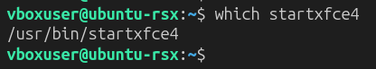

### 4. Définition du mot de passe VNC

Le mot de passe VNC est indispensable pour l'authentification du client. Sans lui, la connexion échoue avec « Authentication failure ».

```bash
vncpasswd
```

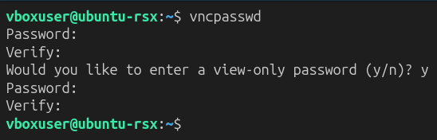

### 5. Initialisation du serveur VNC

```bash
vncserver :1
```

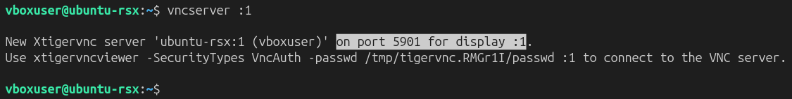

Le serveur écoute sur le **port 5901** (5900 + numéro de display `:1`).

### 6. Arrêt du serveur pour la configuration avancée

```bash
vncserver -kill :1
```

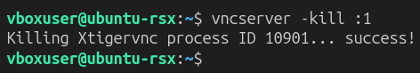

### 7. Personnalisation du fichier de configuration `~/.vnc/xstartup`

Édition du fichier (avec l'utilisateur normal, **sans** `sudo`, pour que le fichier appartienne bien à `vboxuser`) :

```bash
nano ~/.vnc/xstartup
```

Contenu final :

```bash
#!/bin/bash
unset SESSION_MANAGER
unset DBUS_SESSION_BUS_ADDRESS
[ -r $HOME/.Xresources ] && xrdb $HOME/.Xresources
exec dbus-launch --exit-with-session startxfce4
```

> Avec les versions récentes de TigerVNC, un simple `startxfce4 &` en dernière ligne fait quitter le script immédiatement, et la session se ferme aussitôt. L'utilisation de `exec dbus-launch --exit-with-session startxfce4` garde la session ouverte tant que XFCE tourne.

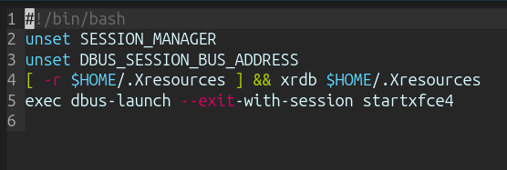

Rendre le script exécutable :

```bash
chmod +x ~/.vnc/xstartup
ls -l ~/.vnc/xstartup
```

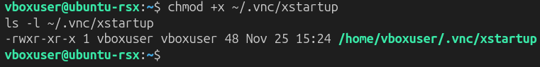

### 8. Relance du serveur VNC

Pour que le serveur soit joignable depuis une autre machine (étape de test de la Partie 2), il est lancé en acceptant les connexions non locales :

```bash
vncserver :1 -localhost no
```

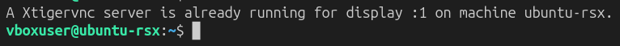

---

## Partie 2 : Connexion depuis une machine cliente

### 1. Installation du client VNC

Sur la machine cliente :

```bash
hostname; whoami
sudo apt install tigervnc-viewer -y
```

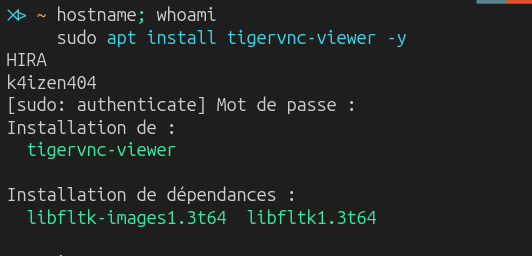

### 2. Connexion au serveur VNC

Lancement de `vncviewer` et saisie de l'adresse du serveur : `192.168.122.116:1` (display `:1`, soit le port 5901).


### 3. Test de la connexion

Après saisie du mot de passe VNC, le bureau XFCE du serveur s'affiche dans la fenêtre du client.

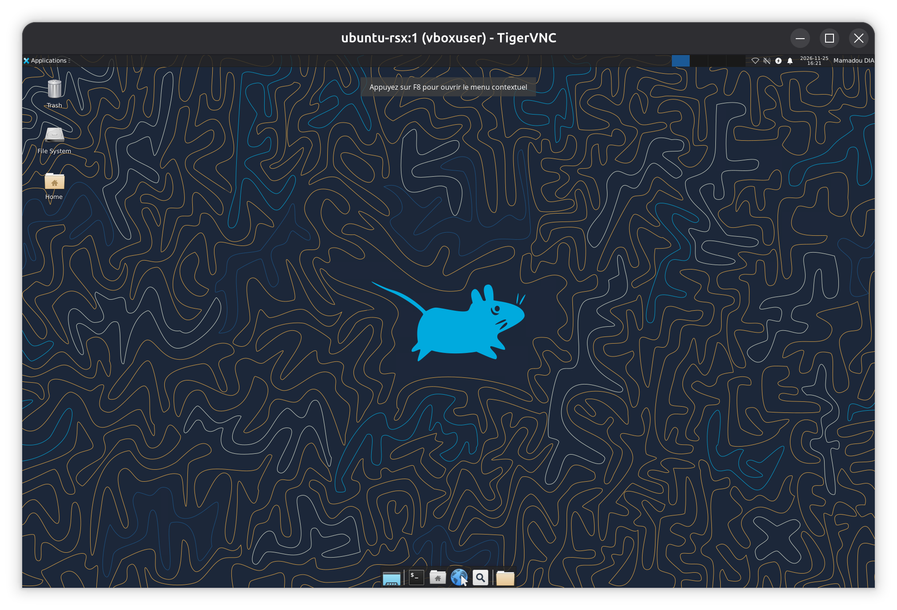

Le terminal et le gestionnaire de fichiers (Thunar) s'ouvrent et s'utilisent normalement à distance, ce qui confirme que la session graphique est pleinement fonctionnelle.

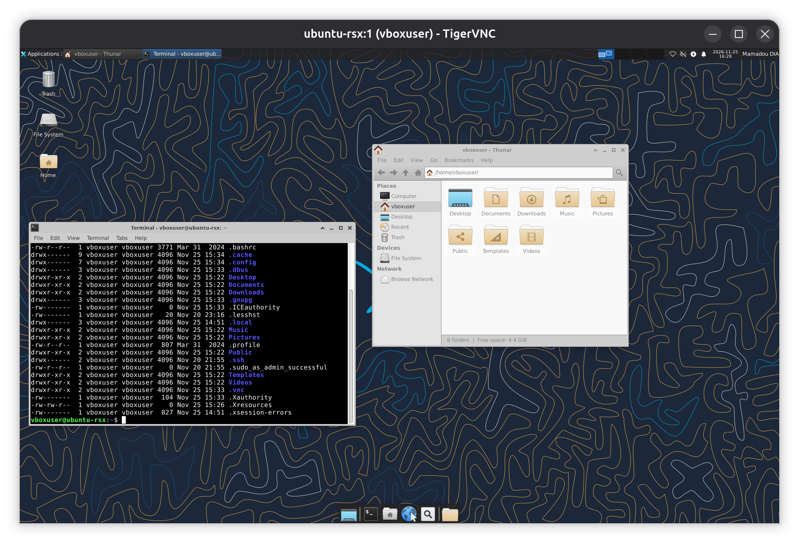

> **Limite constatée** : à ce stade, le trafic VNC circule **sans chiffrement fort** entre le client et le serveur (seule l'authentification par mot de passe est protégée). D'où la Partie 3.

---

## Partie 3 : Sécurisation de la connexion VNC avec un tunnel SSH

### 1. Configuration du tunnel SSH

Depuis la machine cliente :

```bash
ssh -L 5901:localhost:5901 vboxuser@192.168.122.116
```

- `-L 5901:localhost:5901` : le port local 5901 du client est redirigé, à travers le tunnel SSH chiffré, vers le port 5901 de `localhost` **côté serveur**.

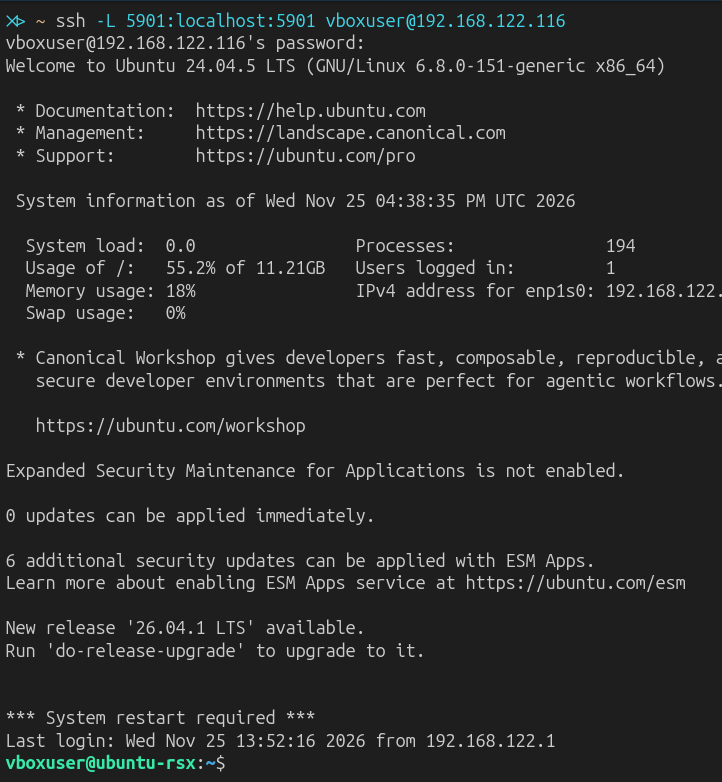

### 2. Connexion au serveur VNC via le tunnel

Le tunnel étant ouvert, le client VNC se connecte à **sa propre machine** (`localhost:5901`), et non plus à l'IP du serveur. Le trafic est alors encapsulé dans SSH.

```bash
vncviewer localhost:5901
```

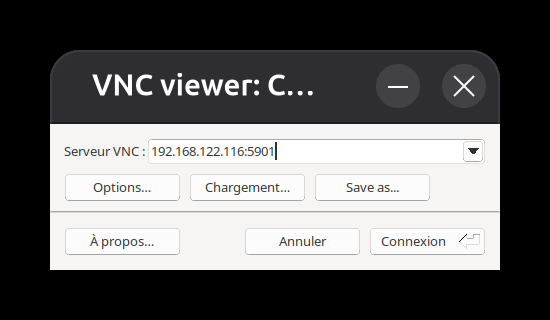

### 3. Vérification du chiffrement

**a) Adresse IP du serveur vue depuis la session VNC**, qui prouve que l'on est bien connecté au bureau de `ubuntu-rsx` :

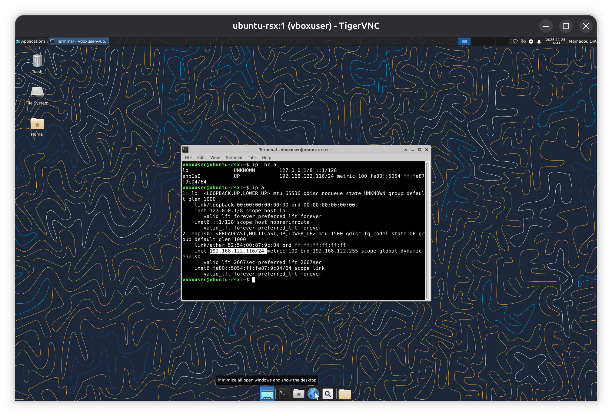

**b) Journal d'authentification SSH sur le serveur** (`/var/log/auth.log` ou `journalctl -u ssh`) : la connexion du client apparaît comme une session SSH (`Accepted password for vboxuser from 192.168.122.1 ... ssh2`), preuve que le flux passe par le tunnel.

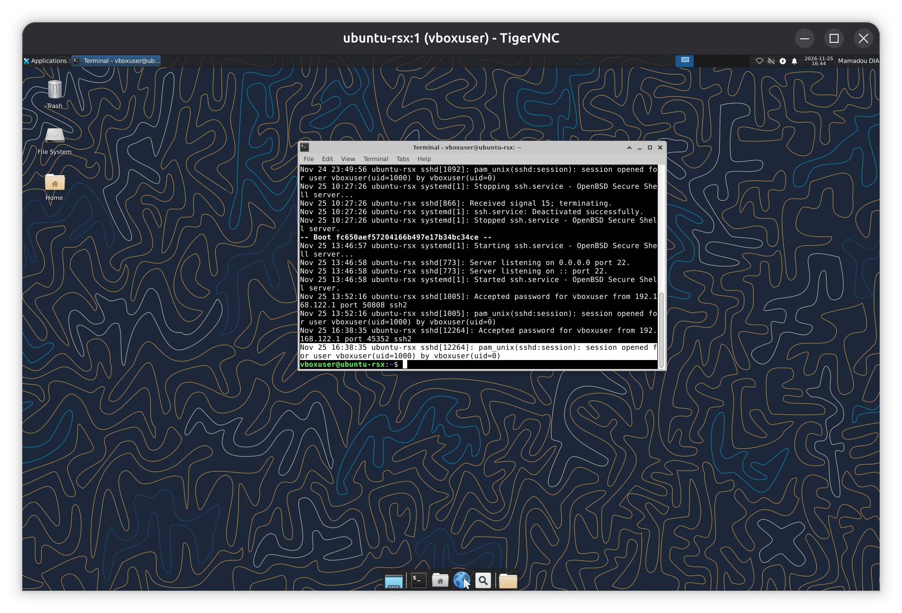

---

## Partie 4 : Accès via navigateur avec noVNC

noVNC est un client VNC écrit en JavaScript/HTML5 : il permet d'accéder au bureau distant **depuis un simple navigateur**, sans installer de client VNC. Il s'appuie sur **websockify**, qui convertit les connexions WebSocket du navigateur en connexions TCP vers le serveur VNC.

### 1. Installation de noVNC

Sur le serveur, noVNC est cloné depuis son dépôt officiel dans `/opt` :

```bash
cd /opt
sudo git clone https://github.com/novnc/noVNC.git
cd /opt/noVNC
ls
```

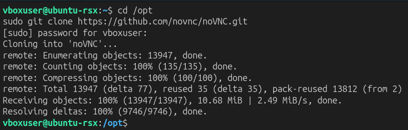

Le contenu du dépôt (dont `vnc.html`, `vnc_lite.html` et le dossier `utils`) confirme que le clonage s'est bien déroulé :

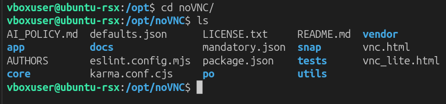

### 2. Installation de websockify

Sur Ubuntu 24.04, websockify est installé depuis les dépôts de la distribution :

```bash
sudo apt install python3-websockify -y
```

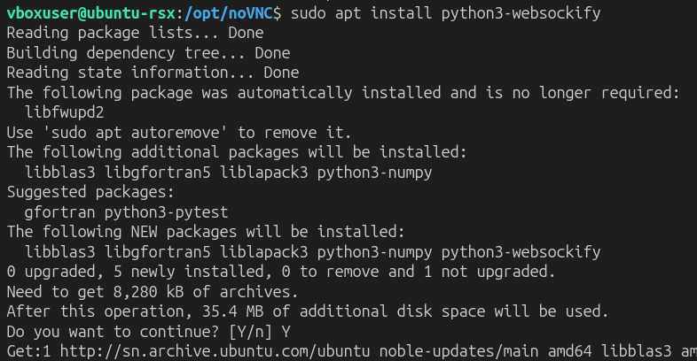

### 3. Préparation de la session VNC

Le serveur VNC tourne déjà sur le display `:1` (message « already running ») :

```bash
vncserver :1
```

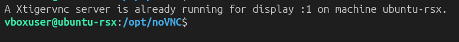

Le fichier `~/.vnc/xstartup` utilisé est celui de la Partie 1 (voir étape 7). La session VNC est ensuite redémarrée pour appliquer la configuration :

```bash
vncserver -kill :1
vncserver :1
```

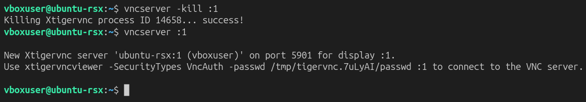

### 4. Lancement de noVNC

```bash
cd /opt/noVNC
./utils/novnc_proxy --vnc localhost:5901
```

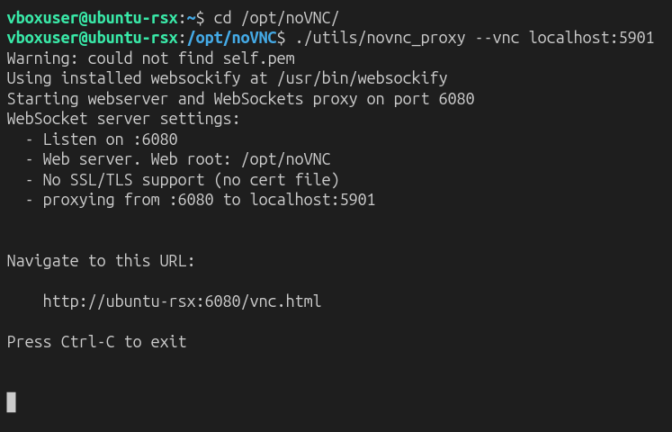

Ce que montre la sortie :

- `Using installed websockify at /usr/bin/websockify` : le websockify installé à l'étape 2 est utilisé.
- `Starting webserver and WebSockets proxy on port 6080` : noVNC sert l'interface web et le proxy sur le **port 6080**.
- `proxying from :6080 to localhost:5901` : les connexions WebSocket reçues sur le port 6080 sont transmises au serveur VNC (port 5901).
- `No SSL/TLS support (no cert file)` : aucun certificat n'est fourni (`self.pem` introuvable), donc **pas de chiffrement HTTPS**.

### 5. Accès à noVNC via le navigateur

Dans le navigateur du client, ouverture de l'URL `http://192.168.122.116:6080/vnc.html` :

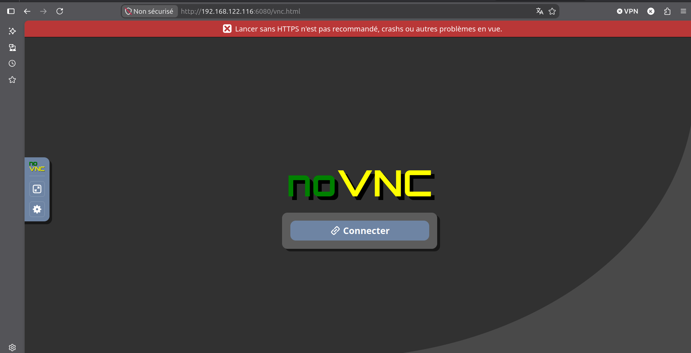

La page noVNC s'affiche, mais le navigateur signale **« Non sécurisé »** et noVNC affiche l'avertissement « Lancer sans HTTPS n'est pas recommandé ». La connexion directe n'est donc pas chiffrée : il faut la sécuriser (étape suivante).

### 6. Sécurisation de la connexion avec un tunnel SSH

Comme pour VNC, on fait passer le port 6080 par un tunnel SSH. Depuis la machine cliente :

```bash
ssh -L 6080:localhost:6080 vboxuser@192.168.122.116
```

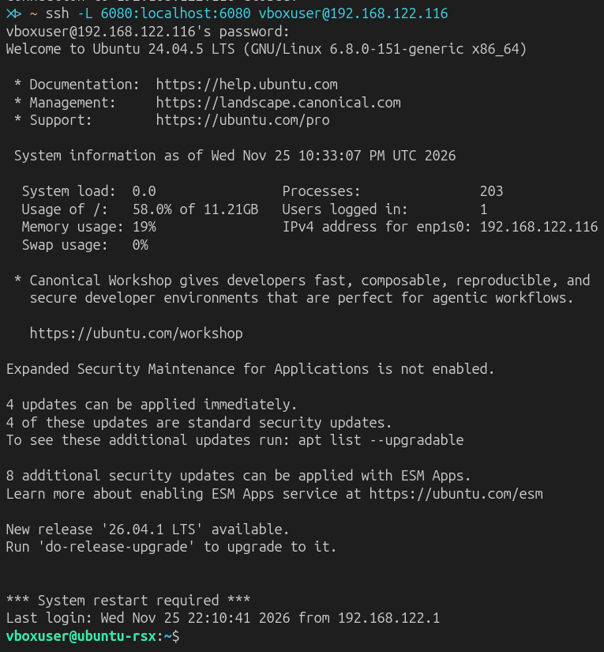

Le tunnel étant ouvert, noVNC est ouvert dans le navigateur via `http://localhost:6080/vnc.html`. L'avertissement « Non sécurisé » disparaît : le flux est désormais encapsulé dans SSH.

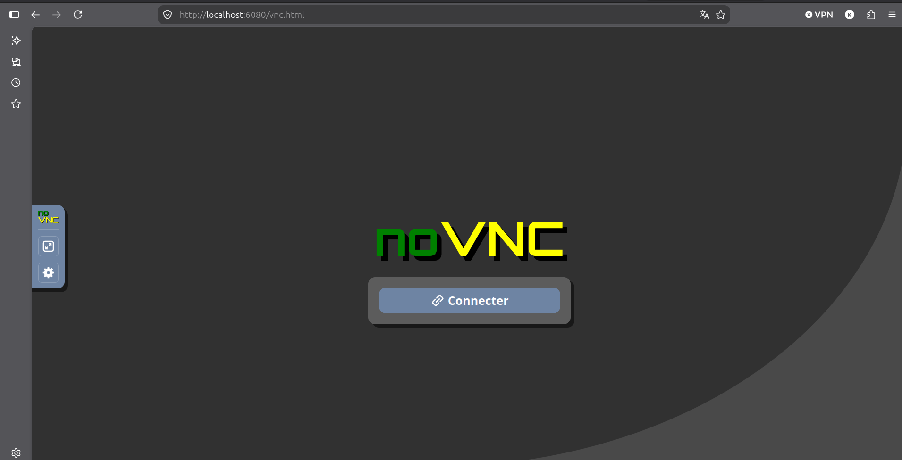

Après clic sur **Connecter** et saisie du mot de passe VNC, le bureau XFCE du serveur s'affiche dans le navigateur. Le terminal ouvert dans la session distante (`ls /opt/noVNC/`) confirme que l'on contrôle bien le serveur `ubuntu-rsx` :

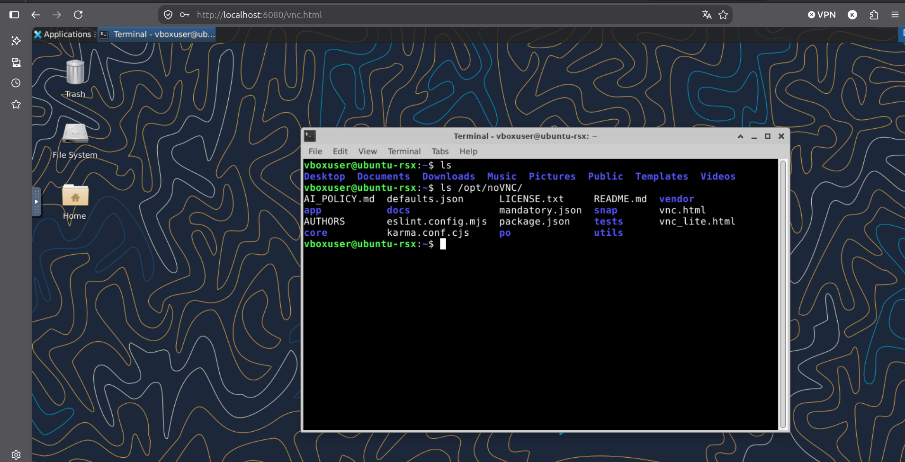

---

## Questions de réflexion

### 1. Quel est le rôle de websockify ?

Un navigateur ne peut pas ouvrir de socket TCP brut : il ne sait communiquer qu'en HTTP et en **WebSocket**. Or un serveur VNC parle le protocole **RFB** directement au-dessus de TCP. `websockify` joue le rôle de **passerelle** : il accepte les connexions WebSocket venant du navigateur (noVNC) et les convertit en flux TCP vers le serveur VNC, et inversement. C'est ce que montre la ligne `proxying from :6080 to localhost:5901`. Sans lui, noVNC ne pourrait pas dialoguer avec le serveur VNC.

### 2. Quelle différence entre noVNC et les clients VNC natifs ?

| | Client natif (TigerVNC viewer…) | noVNC |
|---|---|---|
| Installation côté client | Oui, un logiciel à installer | Aucune, un navigateur suffit |
| Protocole côté client | RFB sur TCP direct | WebSocket via websockify, puis RFB |
| Composant serveur en plus | Non | Oui (noVNC + websockify) |
| Performances | Meilleures (encodages optimisés, moins de couches) | Un peu moindres (JavaScript, couche supplémentaire) |
| Fonctionnalités | Complètes (presse-papiers, réglages fins) | Plus limitées |
| Portabilité | Dépend de l'OS | Fonctionne sur tout appareil avec un navigateur (PC, tablette, téléphone) |

### 3. Quels sont les avantages et inconvénients de noVNC ?

**Avantages**
- Accès depuis n'importe quel appareil doté d'un navigateur, sans installation.
- Pratique pour dépanner ou administrer à distance depuis un poste qui n'est pas le sien.
- Facile à placer derrière un tunnel SSH ou un proxy HTTPS.
- Un seul port web à ouvrir (6080) au lieu de plusieurs ports VNC.

**Inconvénients**
- Performances et fluidité inférieures à un client natif.
- Un composant de plus à installer, maintenir et sécuriser (noVNC + websockify).
- Sans HTTPS/WSS ou tunnel SSH, le trafic n'est pas chiffré (comme l'a montré l'avertissement « Non sécurisé » du navigateur) : le service ne doit jamais être exposé tel quel sur Internet.
- Fonctionnalités limitées (presse-papiers, résolution, périphériques).

---

## Conclusion

Ce TP a permis de mettre en place un serveur VNC TigerVNC avec le bureau XFCE, d'y accéder depuis un client graphique, puis de **sécuriser** cet accès avec un tunnel SSH, VNC seul ne chiffrant pas le contenu de la session. noVNC et websockify ont ensuite permis d'offrir ce même bureau dans un navigateur, au prix d'une couche supplémentaire à administrer. Dans les deux cas, l'accès direct est signalé comme non sécurisé, et le tunnel SSH reste la solution simple et robuste pour ne jamais exposer VNC ou noVNC directement sur le réseau.
