# TP : Mise en place du protocole SSH

- Nom et prénom : Mohamed Aboubacar Aw et Mamadou Dia
- Classe : L3 GLSIA, DGI-ESP / UCAD 2026-2027
- Module : Services Réseaux Avancés
- Enseignant : Dr. GUEYE

## Note préliminaire : organisation du travail en binôme

Ce TP est prévu pour être réalisé en binôme, avec des machines reliées entre elles sur un même réseau. Les deux membres du binôme, Mohamed Aboubacar Aw et Mamadou Dia, n'habitent pas ensemble et ne sont donc pas sur le même réseau local : il n'était pas possible de connecter nos machines l'une à l'autre.

Nous avons donc procédé de la manière suivante :

- Chacun a réalisé l'ensemble du TP de son côté, sur son propre environnement (une machine virtuelle Ubuntu, un poste Windows et une seconde machine Linux), en exécutant lui-même toutes les commandes et tous les tests demandés.
- Nous avons travaillé en même temps, en visioconférence sur Meet. Lorsque l'un de nous rencontrait une difficulté, l'autre l'aidait à la résoudre, et nous avons comparé nos résultats à chaque étape.
- Pour la seconde machine Linux, Mohamed Aboubacar Aw a cloné sa machine virtuelle, tandis que Mamadou Dia a utilisé son PC portable sous Ubuntu comme client Linux.
- Les captures d'écran et les adresses IP présentées dans ce rapport proviennent de l'environnement de Mamadou Dia. Les adresses de Mohamed Aboubacar Aw sont différentes, mais les étapes, les commandes et les résultats sont identiques.

## 1. Objectif

Comprendre comment utiliser SSH pour sécuriser l'accès à une machine distante : installation du serveur, connexion d'un client, authentification par clés et tunnel SSH.

## 2. Environnement de travail

| Machine                                             | Système                         | Adresse IP   | Utilisateur |
| --------------------------------------------------- | ------------------------------- | ------------ | ----------- |
| Serveur SSH (machine virtuelle, nom d'hôte homelab) | Ubuntu 24.04.5 LTS              | 192.168.1.91 | vboxuser    |
| Client Windows (machine virtuelle)                  | Windows 10 (version 10.0.19045) | 192.168.1.93 | mamadou     |
| Client Linux (PC portable, nom d'hôte HIRA)         | Ubuntu 26.04.1 LTS              | 192.168.1.18 | k4izen404   |

Remarque : le client Linux est un PC portable physique (HP EliteBook 840 G5) et non un clone de la machine virtuelle du serveur.

## 3. Étape 1 : Installation de SSH

Installation du serveur OpenSSH sur la machine Linux (serveur) :

```bash
sudo apt update
sudo apt install openssh-server
sudo systemctl enable ssh
sudo systemctl start ssh
```

Vérifications effectuées :

```bash
sudo apt policy openssh-server
sudo service ssh status
netstat -anp | grep -w 22
```

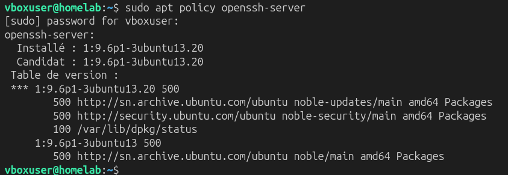

*Figure 1 : Vérification du paquet openssh-server. La version 9.6p1 est installée (les lignes Installé et Candidat sont identiques).*

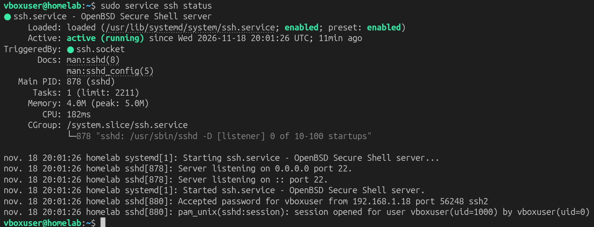

*Figure 2 : Le service ssh est chargé et activé au démarrage (enabled), son état est active (running) et il écoute sur le port 22 en IPv4 (0.0.0.0) et en IPv6 (::).*

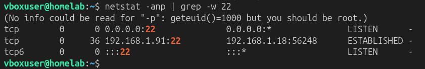

*Figure 3 : Le port 22 est en écoute (LISTEN) en IPv4 et IPv6. La session SSH en cours depuis 192.168.1.18 apparaît aussi, à l'état ESTABLISHED.*

## 4. Étape 2 : Connexion SSH depuis le client

L'adresse IP du serveur est relevée sur le serveur (interface enp0s3 : 192.168.1.91). Depuis le client Windows, la connexion se fait avec :

```bash
ssh vboxuser@192.168.1.91
```

À la première connexion, l'empreinte de l'hôte est affichée puis acceptée (yes), et le mot de passe de l'utilisateur est saisi.

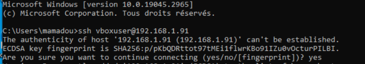

*Figure 4 : Lancement de la connexion depuis le client Windows (C:\Users\mamadou). L'authenticité de l'hôte ne peut pas être établie : l'empreinte est affichée et la saisie de yes est demandée.*

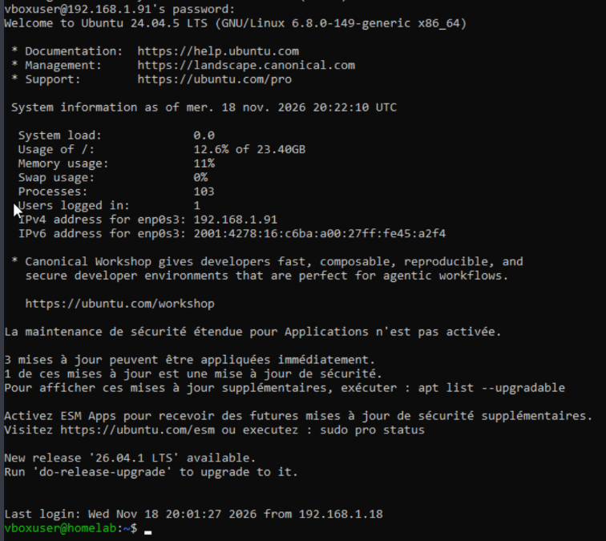

*Figure 5 : Connexion établie. Le message d'accueil d'Ubuntu 24.04.5 LTS affiche l'adresse IPv4 de enp0s3 (192.168.1.91) et le prompt devient vboxuser@homelab.*

## 5. Étape 3 : Configuration des clés SSH

### 5.1 Génération de la paire de clés sur le serveur

```bash
ssh-keygen -t rsa
ls -a
ls .ssh/
```

La paire de clés est créée dans /home/vboxuser/.ssh : id_rsa (clé privée) et id_rsa.pub (clé publique). Le dossier .ssh est visible avec ls -a.

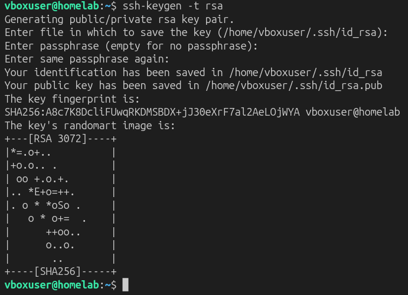

*Figure 6 : Génération de la paire de clés RSA 3072 bits dans /home/vboxuser/.ssh (sans passphrase).*

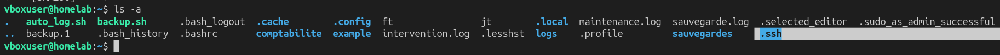

*Figure 7 : Le dossier .ssh est visible dans le répertoire personnel avec ls -a.*

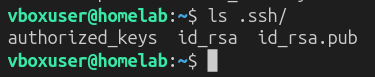

*Figure 8 : Contenu du dossier .ssh : authorized_keys, id_rsa et id_rsa.pub.*

### 5.2 Copie de la clé publique du serveur vers le client Linux

```bash
scp .ssh/id_rsa.pub k4izen404@192.168.1.18:/home/k4izen404
```

La clé publique est envoyée dans le répertoire personnel du client Linux (192.168.1.18). L'empreinte de l'hôte est acceptée (yes) et le mot de passe n'est demandé qu'une seule fois, pour le scp.

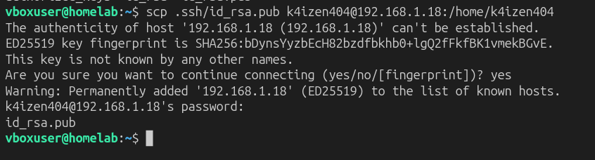

*Figure 9 : Envoi de id_rsa.pub du serveur vers le client Linux avec scp.*

### 5.3 Ajout de la clé publique aux clés autorisées du client

Sur le client Linux, la clé publique reçue est ajoutée au fichier authorized_keys :

```bash
cd
mv id_rsa.pub .ssh/
cd .ssh/
ls
cat id_rsa.pub >> authorized_keys
rm id_rsa.pub
```

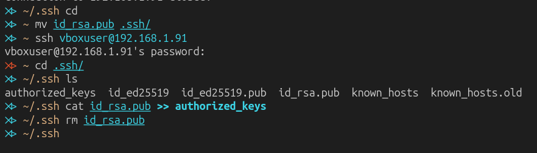

*Figure 10 : Sur le client Linux, id_rsa.pub est déplacé dans ~/.ssh, son contenu est ajouté à authorized_keys, puis le fichier est supprimé.*

### 5.4 Test de connexion sans mot de passe

```bash
ssh k4izen404@192.168.1.18
```

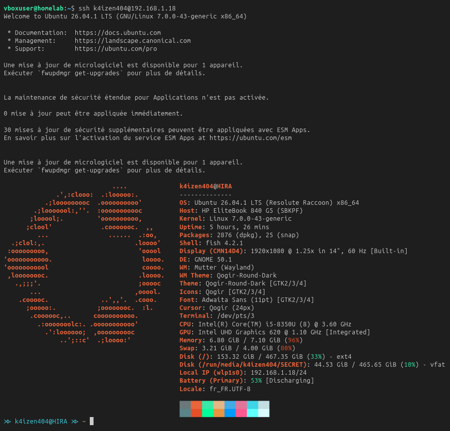

*Figure 11 : Connexion du serveur au client Linux sans saisie de mot de passe. Le prompt devient k4izen404@HIRA.*

## 6. Étape 4 : Tunnel SSH en ligne de commande

Le principe est d'établir un tunnel SSH entre un client et un serveur afin de faire transiter un autre protocole (HTTP, MySQL, FTP...) à travers le port SSH. Les services de test sont installés sur le serveur :

```bash
sudo apt install apache2 mariadb-server
sudo systemctl enable apache2
sudo systemctl status apache2
sudo systemctl enable --now mariadb
sudo systemctl status mariadb
```

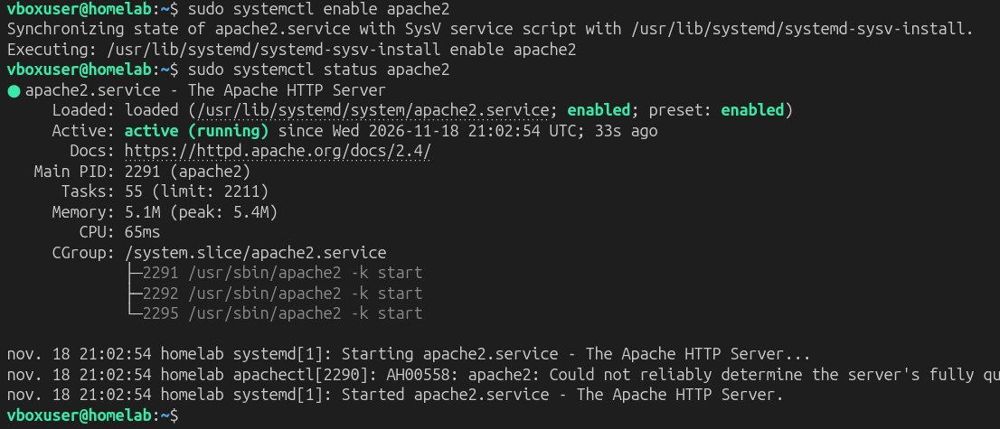

*Figure 12 : Le service Apache2 est actif (active (running)) et activé au démarrage sur le serveur.*

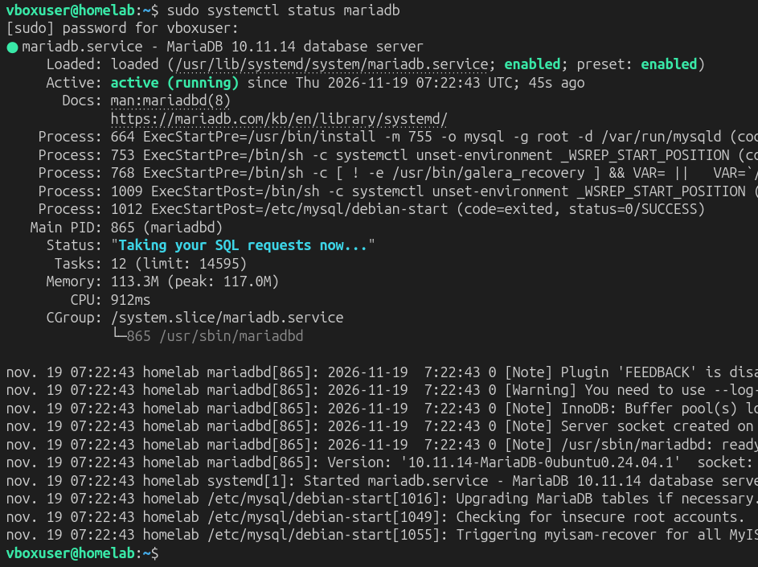

*Figure 13 : Le service MariaDB est actif (active (running)) sur le serveur.*

### 6.1 Tunnel vers le serveur web

Le port local 1024 du client est relié au port 80 du serveur :

```bash
ssh -L 1024:127.0.0.1:80 vboxuser@192.168.1.91
```

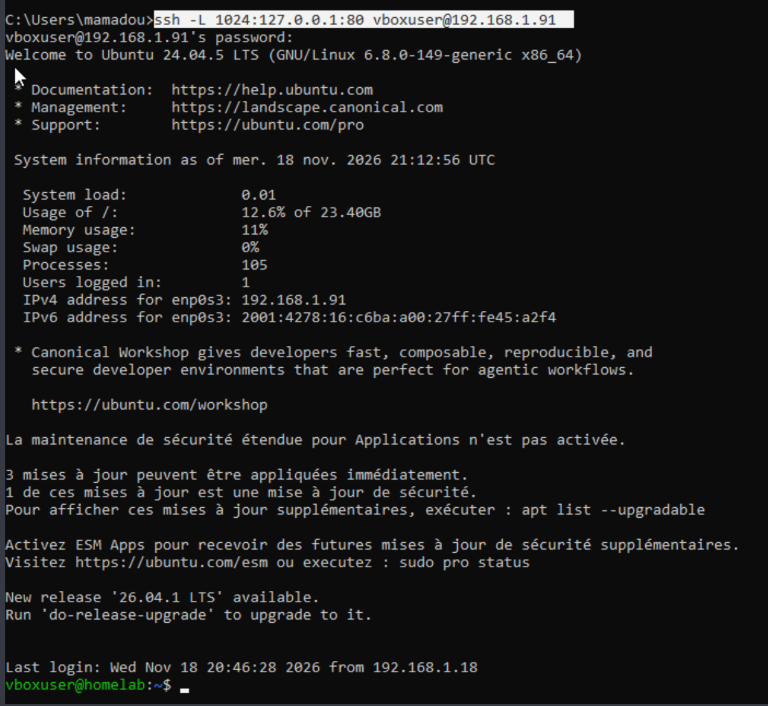

*Figure 14 : Création du tunnel SSH depuis le client Windows (port local 1024 vers le port 80 du serveur).*

Le navigateur du client accède à la page web du serveur via l'adresse http://127.0.0.1:1024.

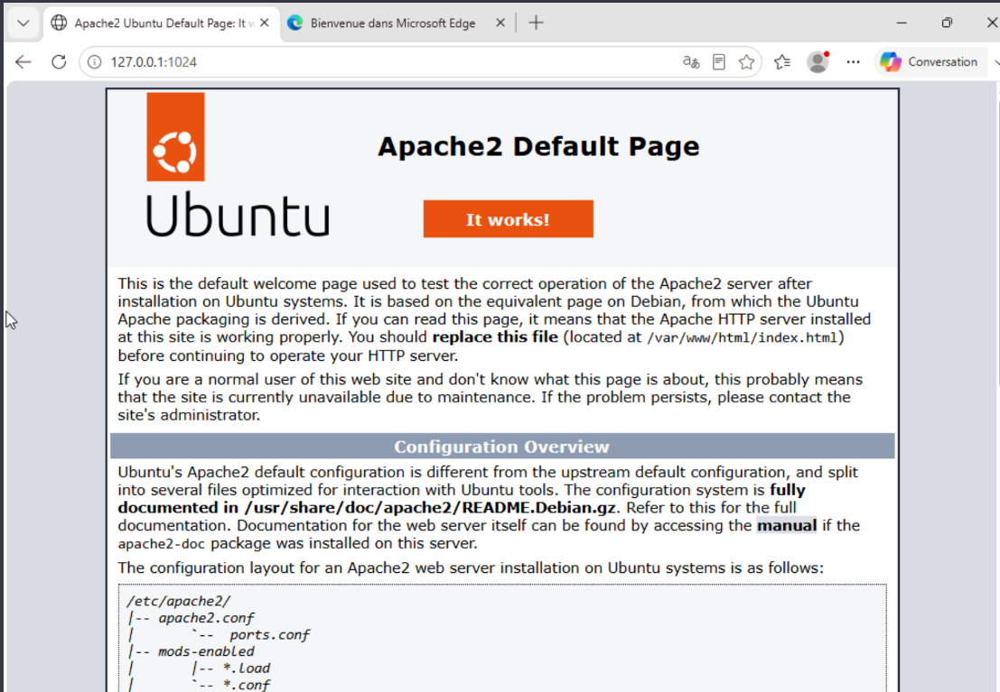

*Figure 15 : La page par défaut d'Apache2 du serveur est affichée dans le navigateur via le tunnel (127.0.0.1:1024).*

### 6.2 Tunnel vers la base de données

Le port local 1024 est cette fois relié au port 3306 (MariaDB) du serveur. Un utilisateur testuser a été créé dans MariaDB pour le test :

```bash
sudo mariadb
CREATE USER 'mamadou'@'localhost' IDENTIFIED BY '********';
CREATE DATABSE tp_ssh;
GRANT ALL PRIVILEGES ON tp_ssh.* TO 'mamadou'@'localhost';
FLUSH PRIVILEGES;
EXIT;
```

```bash
ssh -L 1024:127.0.0.1:3306 vboxuser@192.168.1.91
```


![[16_tunnel_mariadb.png]]

*Figure 16 : Création du tunnel SSH (port local 1024 vers le port 3306 de MariaDB).*

Le client Windows utilise HeidiSQL avec les paramètres : hôte 127.0.0.1, utilisateur mamadou, port 1024.

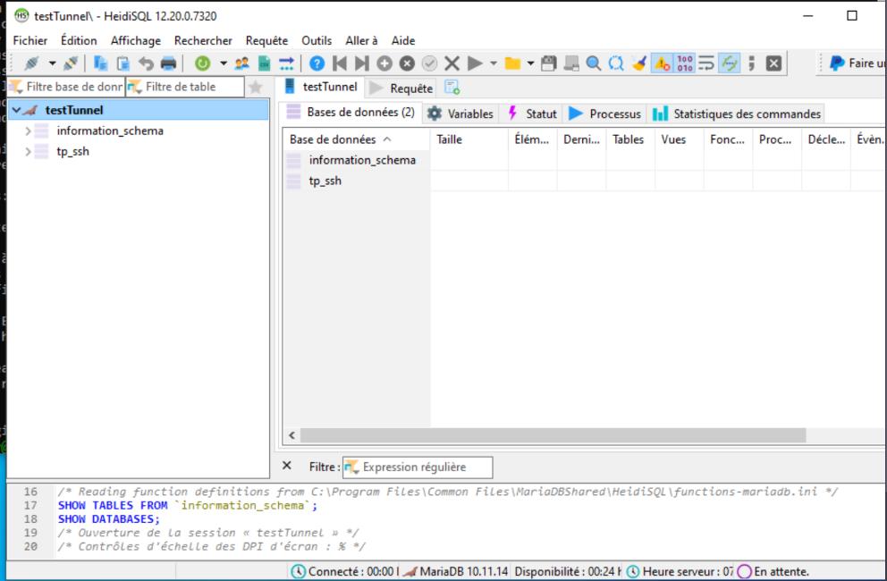

*Figure 17 : HeidiSQL connecté à MariaDB à travers le tunnel SSH. Les bases de données du serveur sont listées.*

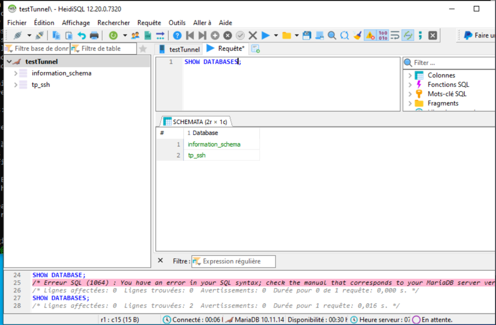

*Figure 18 : Exécution de la requête SHOW DATABASES; depuis HeidiSQL. Le résultat confirme l'accès à la base de données distante par le tunnel.*

## 7. Conclusion

Ce TP a permis d'installer et de vérifier un serveur SSH, de s'y connecter depuis un client Windows, de mettre en place l'authentification par clés entre deux machines Linux, et de créer des tunnels SSH pour accéder à un serveur web et à une base de données MariaDB à travers le port 22.
