<div align="center">


### Université Cheikh Anta Diop de Dakar (UCAD)
**École Supérieure Polytechnique (ESP)**  
**Département Génie Informatique**  
**Année Universitaire 2026–2027**  
**Licence 3 en Génie Logiciel et Système d'Information (L3 GLSI C)**

---

# Compte rendu du TP : Configuration et Utilisation de Remote Desktop Protocol (RDP)

**Cours :** Services Réseaux Avancés  
**Enseignant :** Dr GUEYE  
**Étudiant :** Ehi Diamhen Winter  

</div>

---

## Sommaire

1. [Objectif et Pré-requis](#1-objectif-et-pré-requis)
2. [Environnement de travail](#2-environnement-de-travail)
3. [Partie 1 : Activer le Bureau à Distance sur le Serveur Windows](#3-partie-1--activer-le-bureau-à-distance-sur-le-serveur-windows)
4. [Partie 2 : Connexion au Serveur RDP depuis un Client Windows](#4-partie-2--connexion-au-serveur-rdp-depuis-un-client-windows)
5. [Partie 3 : Connexion au Serveur RDP depuis un Client Linux](#5-partie-3--connexion-au-serveur-rdp-depuis-un-client-linux)
6. [Partie 4 : Activation du service RDP sous VirtualBox pour accès à une machine](#6-partie-4--activation-du-service-rdp-sous-virtualbox-pour-accès-à-une-machine)
7. [Synthèse et analyse sécuritaire](#7-synthèse-et-analyse-sécuritaire)

---

## 1. Objectif et Pré-requis

**Objectif :** Configurer et utiliser le protocole RDP (*Remote Desktop Protocol*) pour accéder à un ordinateur Windows à distance de manière sécurisée, ainsi que tester l'accès distant vers une machine virtuelle via le serveur VRDP intégré de VirtualBox.

**Pré-requis :**
* Une machine Windows (édition Pro, Enterprise ou Education) pour servir de serveur RDP.
* Une machine Windows ou Linux pour agir comme client RDP.
* Accès administrateur sur la machine serveur.

---

## 2. Environnement de travail

L'infrastructure réseau repose sur une machine physique hôte sous Windows 10 Professionnel hébergeant une machine virtuelle Ubuntu sous Oracle VM VirtualBox. La carte réseau de la machine virtuelle est configurée en mode **Accès par pont (Bridged Adapter)** afin que les deux machines communiquent directement sur le même sous-réseau local (`192.168.1.0/24`).

| Rôle | Machine | Système d'exploitation | Utilisateur | Adresse IP |
| :--- | :--- | :--- | :--- | :--- |
| **Serveur RDP / Hôte** | `DESKTOP-KOLK3MG` (HP EliteBook) | Windows 10 Pro (22H2) | `HP` | `192.168.1.10` |
| **Client RDP / Invité** | `winbuntu` (VM VirtualBox) | Ubuntu 25.04 (64-bit) | `ehiwinter` | `192.168.1.11` |

---

## 3. Partie 1 : Activer le Bureau à Distance sur le Serveur Windows

### 3.1. Vérification de la Version de Windows et de l'adresse IP
Ouverture de **Paramètres > Système > Informations système** (*Settings > System > About*) pour confirmer que le système exécute bien **Windows 10 Pro** (version `22H2`, build `19045.6456`), édition requise pour héberger un serveur RDP.

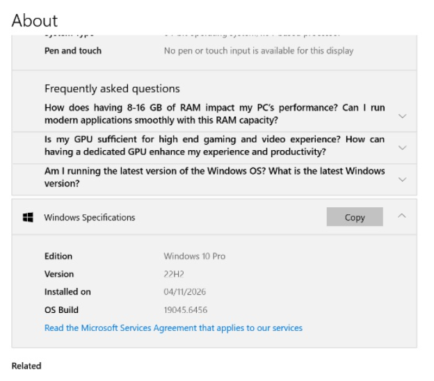

L'exécution de la commande `ipconfig` dans l'invite de commandes Windows permet de relever l'adresse IPv4 locale de la machine serveur : **`192.168.1.10`** (masque `255.255.255.0`, passerelle `192.168.1.1`).

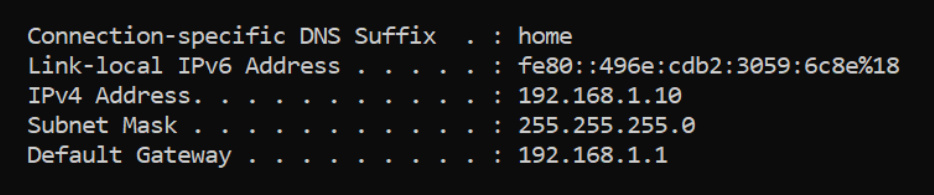

### 3.2. Activer le Bureau à Distance et Configurer l'Accès des Utilisateurs
1. Accès à **Paramètres > Système > Bureau à distance** (*Settings > System > Remote Desktop*) et activation de l'option **Activer le Bureau à distance** (*Enable Remote Desktop* sur **On**).
2. Ouverture de **Sélectionner les utilisateurs pouvant utiliser le Bureau à distance** (*Remote Desktop Users*) : le compte administrateur local **`HP`** possède déjà les privilèges d'accès distant (`HP already has access.`).

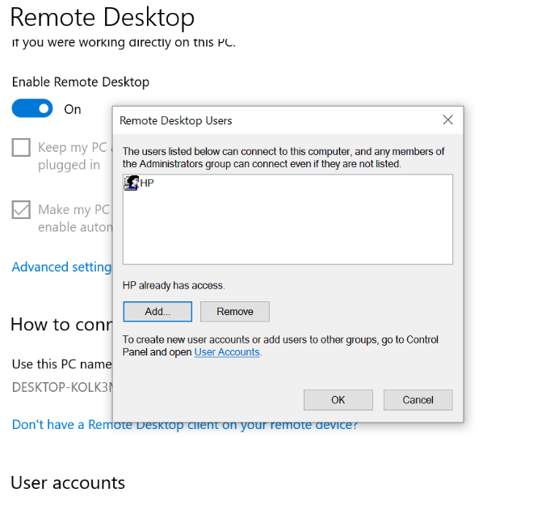

### 3.3. Vérifier les Paramètres du Pare-feu et le service RDP
Dans le **Panneau de configuration > Pare-feu Windows Defender > Autoriser une application ou une fonctionnalité via le Pare-feu Windows Defender**, les règles **Remote Desktop** et **Remote Desktop (WebSocket)** sont activées pour les profils **Privé** (*Private*) et **Public** afin d'autoriser le trafic entrant sur le port **TCP 3389**.

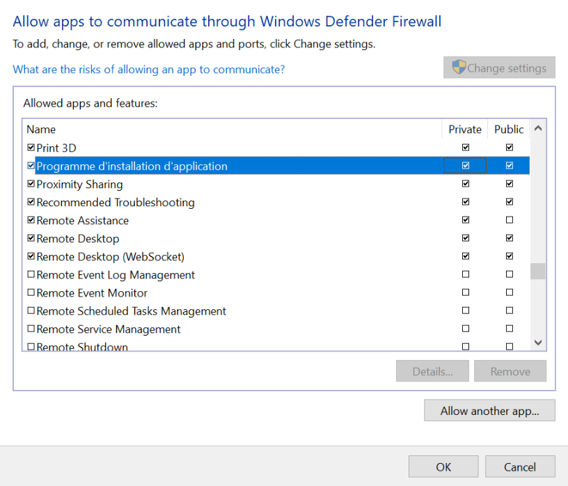

Vérification de l'état du service **Services Bureau à distance (`TermService`)** et de l'écoute réseau sur le port `3389` en invite de commandes administrateur :

```cmd
sc config TermService start= auto
net start TermService
netstat -ano | findstr :3389
```

---

## 4. Partie 2 : Connexion au Serveur RDP depuis un Client Windows

1. **Ouvrir l'Outil de Connexion Bureau à Distance :** lancement de l'utilitaire natif Windows via la commande `mstsc` (`Win + R`).
2. **Saisir les Informations de Connexion et Gérer les Options :** déploiement de **Afficher les options** (*Show Options*) pour renseigner les paramètres de connexion dans l'onglet **General** (adresse cible, nom d'utilisateur **`HP`**) et vérifier les réglages d'affichage (*Display*), de ressources locales (*Local Resources* : presse-papiers, lecteurs) et d'expérience (*Experience*).

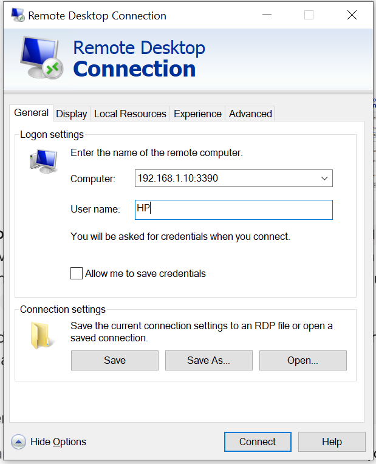

> **Remarque technique :** Lorsqu'une connexion RDP est initiée depuis l'hôte Windows vers sa propre adresse IP (`192.168.1.10`), Windows affiche un avertissement indiquant qu'une session console locale est déjà active. Ce comportement confirme le fonctionnement monosession de Windows 10 Professionnel.

---

## 5. Partie 3 : Connexion au Serveur RDP depuis un Client Linux

### 5.1. Installer un Client RDP (Remmina)
Sur la machine virtuelle cliente Ubuntu **`winbuntu`**, mise à jour des dépôts et installation de **Remmina** avec le greffon RDP (`remmina-plugin-rdp`) :

```bash
sudo apt update && sudo apt install remmina remmina-plugin-rdp -y
```

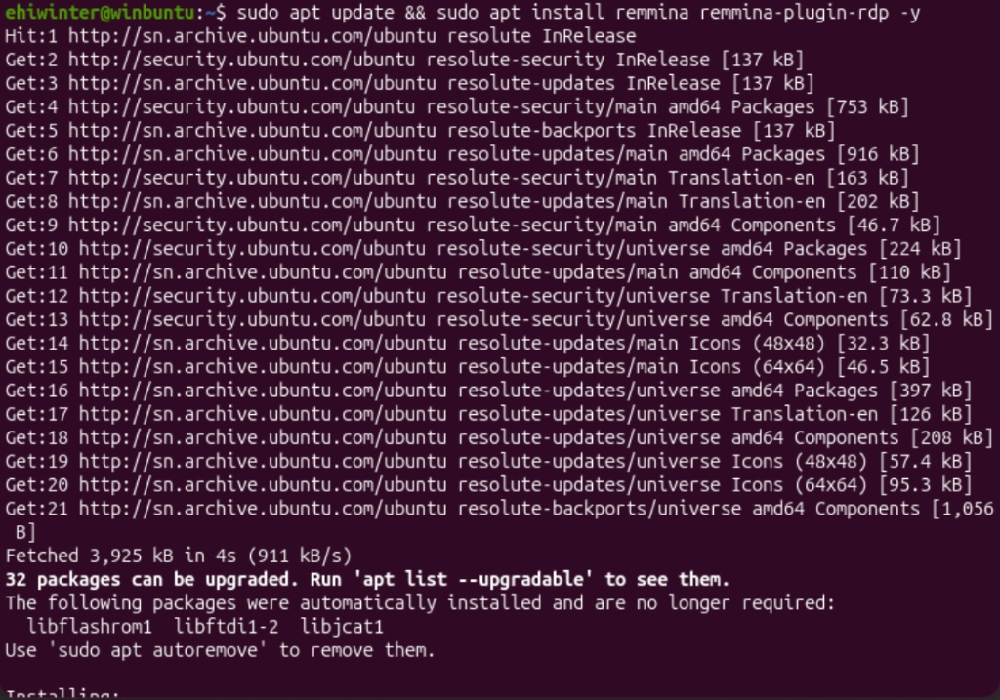

Vérification de la présence du binaire exécutable avec `which remmina` :

```bash
ehiwinter@winbuntu:~$ which remmina
/usr/bin/remmina
```

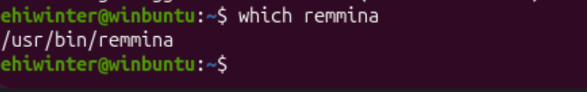

### 5.2. Lancer Remmina et Configurer la Connexion
Ouverture de **Remmina**, création d'un nouveau profil de connexion (**`+`**) et configuration des paramètres dans l'onglet **Basic** :
* **Protocol :** `RDP - Remote Desktop Protocol`
* **Server :** `192.168.1.10`
* **Username :** `HP`
* **Password :** mot de passe du compte Windows

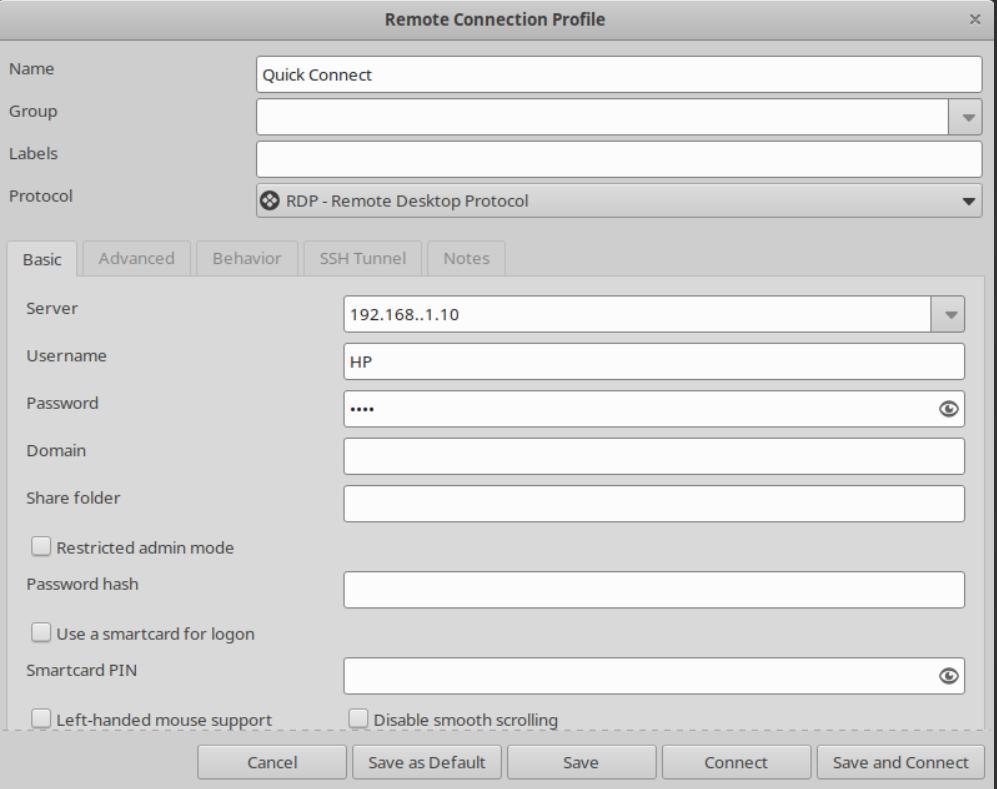

### 5.3. Tester la Connexion et Valider le Certificat
Lors de la connexion (**Save and Connect**), Remmina affiche les détails du certificat auto-signé du serveur Windows (**`CN = DESKTOP-KOLK3MG`**) afin d'établir le canal chiffré TLS. Après validation avec **Yes**, l'authentification aboutit et l'écran local de Windows 10 Pro se verrouille automatiquement pour transférer la session graphique au client Ubuntu.

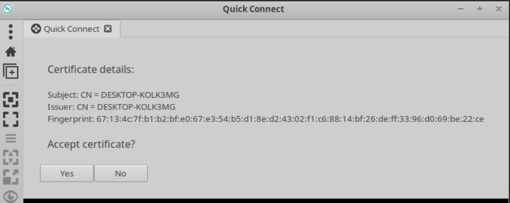

---

## 6. Partie 4 : Activation du service RDP sous VirtualBox pour accès à une machine

### 6.1. Configuration du serveur VRDP dans VirtualBox
Après arrêt propre de la machine virtuelle `winbuntu` (`sudo poweroff`), ouverture de **Oracle VM VirtualBox > Configuration > Affichage > Bureau à distance** :
* **Activer le serveur :** coché
* **Server Port :** **`3390`**
* **Security Method :** `TLS`
* **Authentication Method :** `Aucune` (*Null*)

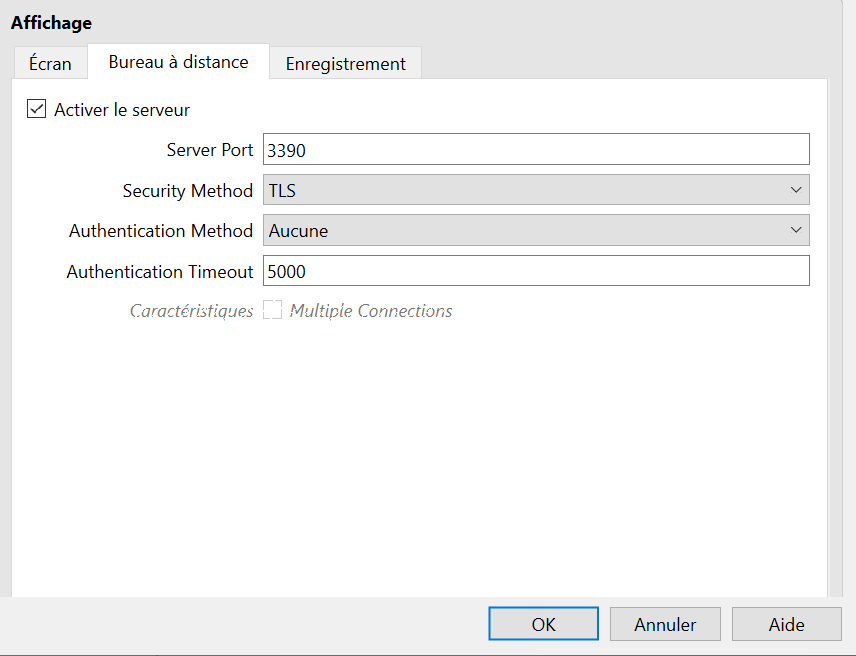

> **Justification du port `3390` :** Le port RDP standard `3389` étant déjà utilisé sur l'interface `192.168.1.10` par le service Bureau à distance natif de Windows 10 Pro, l'attribution du port **`3390`** au serveur VRDP de VirtualBox évite tout conflit de port sur l'hôte.

### 6.2. Test de bon fonctionnement depuis Windows via `mstsc`
1. Démarrage de la machine virtuelle `winbuntu`.
2. Lancement de **Remote Desktop Connection (`mstsc`)** sur Windows avec l'adresse de l'hôte suivie du port personnalisé : **`192.168.1.10:3390`**.
3. Validation de l'avertissement de sécurité relatif au certificat auto-signé émis par VirtualBox pour la VM **`winbuntu`** en cliquant sur **Yes**.

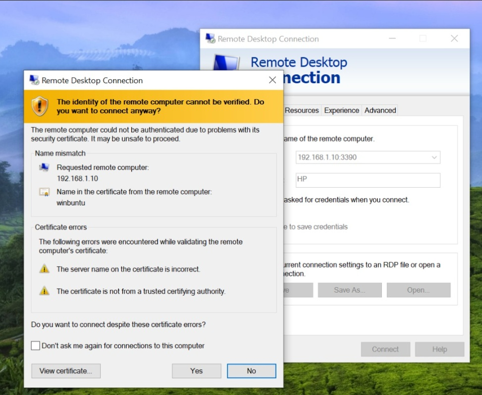

4. Le bureau graphique complet d'Ubuntu (`ehiwinter@winbuntu`) s'affiche dans la fenêtre cliente Windows **`192.168.1.10:3390 - Remote Desktop Connection`**.

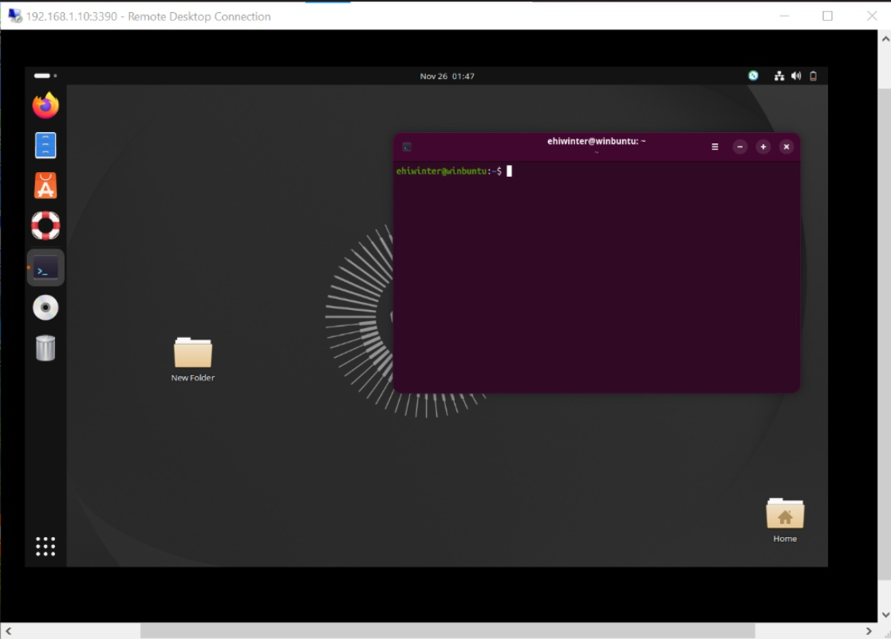

5. L'exécution de la commande `ip a` dans le terminal distant de la VM confirme que l'interface réseau **`enp0s3`** possède bien l'adresse IP **`192.168.1.11/24`** sur le réseau local.

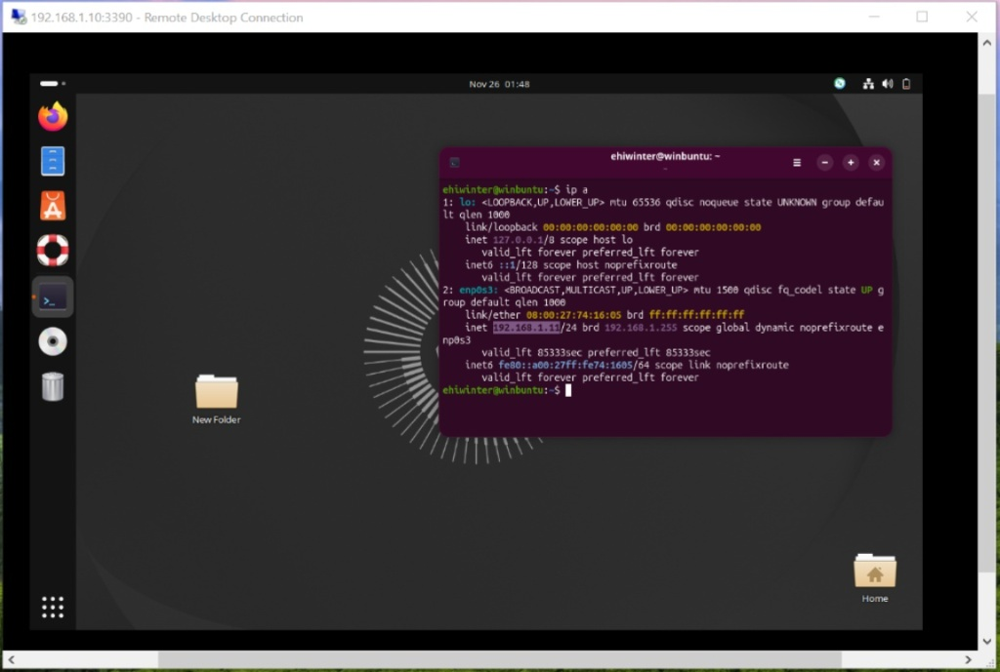

---

## 7. Synthèse et analyse sécuritaire

| Critère | RDP natif (Windows / Remmina) | Serveur VRDP (Oracle VirtualBox) |
| :--- | :--- | :--- |
| **Niveau d'exécution** | Système d'exploitation (couche OS) | Hyperviseur (indépendant de l'OS invité) |
| **Port TCP utilisé** | `3389` | `3390` (personnalisé pour éviter tout conflit) |
| **Authentification** | Comptes utilisateurs Windows (`HP`) | Gérée par l'hyperviseur (`Null`, `External`, `Guest`) |
| **Chiffrement** | TLS / NLA (*Network Level Authentication*) | TLS avec certificat auto-signé VirtualBox |

**Bonnes pratiques de sécurité :** En environnement de production, il est recommandé d'activer l'authentification au niveau du réseau (**NLA**), d'imposer des mots de passe robustes, de filtrer les adresses IP autorisées à joindre les ports RDP via le pare-feu, et d'utiliser un tunnel VPN ou SSH pour tout accès depuis un réseau externe.
